 

<h2 align="center">About</h2>

Computer Science student at <b>Africa Vision University</b> (Abidjan, Côte d'Ivoire), GPA 3.8/4.0. 
I build <b>production web apps with AI built in</b>: LLM integration, semantic search, async data pipelines and agent workflows. 
Security is part of the design: authentication, input validation and prompt-injection defense at every layer.

<h2 align="center">Featured work</h2>

<table>
<tr>
<td width="50%" valign="top">

### [AI-Grader](https://github.com/issikaaymeric/AI-Grader)
Rubric-agnostic assignment grading with structured, criterion-level feedback. Pydantic-validated model output, authentication, and prompt-injection defenses.

    

</td>
<td width="50%" valign="top">

### [Susie — AI coding assistant](https://github.com/issikaaymeric/Susie)
VS Code extension backed by a Fastify service that streams DeepSeek responses over WebSockets, with per-install authentication and isolated sessions.

   

</td>
</tr>
<tr>
<td width="50%" valign="top">

### [Local-First AI Agent](https://github.com/issikaaymeric/ai-agent)
Desktop and CLI assistant with persistent SQLite memory, automatic multi-provider LLM fallback, human approval gates for sensitive commands, and Whisper voice input.

   

</td>
<td width="50%" valign="top">

### [Async Web Scraper & Pipeline](https://github.com/issikaaymeric/async_web_scrapper_pipeline)
Concurrent crawler with configurable limits, retries, and robots.txt compliance, feeding a Streamlit price-tracking dashboard with CSV export.

    

</td>
</tr>
<tr>
<td width="50%" valign="top">

### [Stock Price Direction Prediction](https://github.com/issikaaymeric/Stock-Price-Prediction)
Time-series classification with chronological holdout and expanding-window cross-validation to prevent look-ahead bias, benchmarked honestly against a naive baseline.

   

</td>
<td width="50%" valign="top">

### Atihmam ATS · internship, private
Production applicant-tracking system: automated CV ingestion, data extraction, duplicate detection, semantic matching, and LLM-assisted candidate evaluation.

  

</td>
</tr>
</table>

More on my <a href="https://github.com/issikaaymeric?tab=repositories">repositories page</a> and the <a href="https://www.issikaaymeric.online/">portfolio</a>.

<h2 align="center">Security</h2>

<table>
<tr>
<td width="50%" valign="top">

**Wazuh SIEM home lab** 
Sysmon telemetry, real-time file integrity monitoring, VirusTotal integration and CVE triage by CVSS.

**Linux firewall hardening** 
Default-deny `iptables` with stateful rules and logging.

</td>
<td width="50%" valign="top">

**Segmented campus network** 
Six VLANs, inter-VLAN routing, DHCP and 802.1Q trunks in Cisco Packet Tracer.

**TryHackMe, top 20%** 
28 rooms: web exploitation, privilege escalation, hash cracking, Active Directory. [View profile](https://tryhackme.com/p/issikathereal)

</td>
</tr>
</table>

<h2 align="center">Tech stack</h2>

 
 

<h2 align="center">Certifications</h2>

<h2 align="center">GitHub stats</h2>

 

